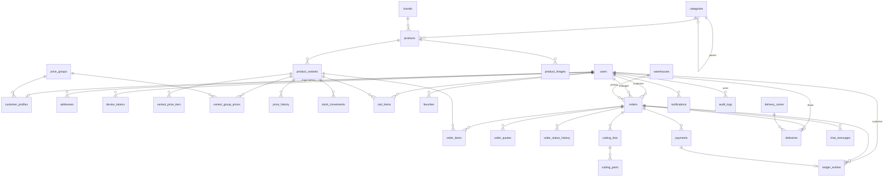

# 01. Ma'lumotlar modeli (ER)

Konvensiyalar:
- `id` — UUID (v7, vaqt bo'yicha tartiblanadi).
- Pul — `BIGINT`, so'mda (tiyinsiz). Float ishlatilmaydi.
- Miqdor — `NUMERIC(12,3)` (12.5 m kromka, 3 list).
- Har jadvalda `created_at`, `updated_at` bor (diagrammada ko'rsatilmagan).
- Matnlar ikki tilda: `name_uz`, `name_ru`.

## Diagramma

## Jadvallar

### Foydalanuvchilar

**users**
| maydon | tip | izoh |
|---|---|---|
| id | uuid PK | |
| phone | varchar UNIQUE | +998XXXXXXXXX, login shu orqali |
| full_name | varchar | |
| role | enum | `CUSTOMER`, `MANAGER`, `SUPER_ADMIN`, `WAREHOUSE`, `DRIVER` |
| locale | enum | `uz`, `ru` |
| is_active | bool | bloklash uchun |
| last_login_at | timestamptz | |

**customer_profiles** (1:1 users, faqat CUSTOMER uchun)
| maydon | tip | izoh |
|---|---|---|
| user_id | uuid PK FK | |
| type | enum | `INDIVIDUAL`, `MASTER` (usta), `COMPANY` |
| company_name, inn, bank_details (jsonb) | | yuridik shaxs uchun |
| price_group_id | FK null | null bo'lsa chakana narx |
| credit_limit | bigint | 0 = nasiya yo'q |
| payment_term_days | int | nasiya muddati, masalan 15 |
| allowed_payment_methods | enum[] | admin belgilaydi |
| balance_cached | bigint | ledger yig'indisi (tez o'qish uchun, tranzaksiyada yangilanadi). Musbat = mijoz qarzdor |

**price_groups**: `id, name, description` (Usta, Diler, VIP).

**addresses**: `id, user_id, label ("Sex", "Obyekt"), address_text, lat, lng, floor, needs_loaders bool, comment`.

**otp_codes**: `phone, code_hash, expires_at, attempts, sent_count`. Rate-limit Redis'da.

**device_tokens**: `id, user_id, token, platform, last_seen_at`.

**refresh_sessions**: `id, user_id, token_hash, family_id, expires_at, revoked_at, user_agent`. Refresh token o'zi saqlanmaydi, faqat SHA-256 hash. Har refresh'da rotatsiya; bekor qilingan token qayta kelsa butun `family_id` bekor qilinadi.

### Katalog

**categories**: `id, parent_id, name_uz, name_ru, slug, image_url, sort_order, is_active`.

**brands**: `id, name, logo_url`.

**products**
| maydon | tip | izoh |
|---|---|---|
| id | uuid PK | |
| code | varchar UNIQUE null | Excel import'da variantlarni bitta mahsulotga guruhlash kaliti |
| category_id, brand_id | FK | |
| name_uz, name_ru, description_uz, description_ru | | |
| unit | enum | `PIECE`, `SHEET`, `METER`, `SQM`, `KG`, `SET`, `PACK` |
| min_qty | numeric | minimal buyurtma |
| qty_step | numeric | karralik (100 dona pachka → 100) |
| weight_kg, volume_m3 | numeric | 1 birlik uchun, yetkazish hisobi |
| kind | enum | `GOODS`, `BOARD` (raspilga yaroqli plita), `EDGE` (kromka) |
| board_length_mm, board_width_mm, thickness_mm | int null | faqat BOARD uchun |
| is_active | bool | |

**product_images**: `id, product_id, url, sort_order`.

**product_variants**
| maydon | tip | izoh |
|---|---|---|
| id | uuid PK | |
| product_id | FK | |
| sku | varchar UNIQUE | artikul |
| attributes | jsonb | `{ "color": "Oq", "decor_code": "W980", "thickness": 16 }` |
| swatch_url | varchar | rang/dekor namunasi |
| base_price | bigint | chakana narx |
| stock_qty | numeric | fizik qoldiq |
| reserved_qty | numeric | tasdiqlangan buyurtmalarga band. Sotuvga mavjud = stock − reserved |
| low_stock_threshold | numeric | |
| availability | enum | `IN_STOCK`, `ON_ORDER`, `OUT_OF_STOCK` (qoldiqdan avtomatik, ON_ORDER qo'lda) |
| lead_time_days | int | ON_ORDER uchun |
| is_active | bool | |

CHECK: `stock_qty >= 0`, `reserved_qty >= 0`, `reserved_qty <= stock_qty` (ON_ORDER bundan mustasno, qarang: savollar).

**variant_price_tiers**: `variant_id, min_qty, price` — UNIQUE(variant_id, min_qty).

**variant_group_prices**: `variant_id, price_group_id, price` — UNIQUE pair.

Narx tanlash qoidasi (bitta joyda, `PricingService`): mijoz guruhi narxi, pog'onali narx va asosiy narx ichidan **eng arzoni** olinadi.

**price_history**: `id, variant_id, old_price, new_price, source (MANUAL/BULK/IMPORT), changed_by, created_at`.

**stock_movements**
| maydon | izoh |
|---|---|
| type | `IN` (kirim), `OUT` (jo'natildi), `ADJUST` (inventarizatsiya), `RESERVE`, `RELEASE` |
| qty | musbat, yo'nalish type'dan. Faqat `ADJUST` ishorali (inventarizatsiya farqi) |
| order_id | null bo'lishi mumkin |
| reason, user_id | |

### Savat va sevimlilar

**cart_items**: `user_id, variant_id, qty` — PK(user_id, variant_id). Server-side, ko'p qurilmada bir xil.

**favorites**: `user_id, product_id`.

### Buyurtmalar

**orders**
| maydon | tip | izoh |
|---|---|---|
| id | uuid PK | |
| number | varchar UNIQUE | `MO-2026-000123`, odam o'qiydigan |
| customer_id | FK users | |
| manager_id | FK users null | biriktirilgan menejer |
| status | enum | qarang 02-state-machine.md |
| delivery_type | enum | `DELIVERY`, `PICKUP` |
| address_snapshot | jsonb | manzil nusxasi (keyin o'zgarsa ham saqlanadi) |
| pickup_warehouse_id | FK null | |
| delivery_date, delivery_slot | date, varchar | |
| vehicle_type | enum null | `DAMAS`, `LABO`, `ISUZU`, ... |
| items_total | bigint | |
| services_total | bigint | raspil + kromkalash |
| delivery_fee | bigint | |
| discount_total | bigint | |
| grand_total | bigint | hammasi |
| paid_total | bigint | tasdiqlangan to'lovlar yig'indisi |
| payment_terms | enum | `PREPAID`, `ADVANCE`, `ON_DELIVERY`, `CREDIT` |
| advance_amount | bigint | ADVANCE uchun |
| due_date | date null | CREDIT uchun |
| total_weight_kg, total_volume_m3 | numeric | |
| customer_comment | text | |
| idempotency_key | varchar | UNIQUE(customer_id, idempotency_key) |
| current_quote_id | FK null | |
| cancel_reason, cancelled_by | | |
| confirmed_at, delivered_at, completed_at, cancelled_at | timestamptz | |

**order_items** — narx va nom SNAPSHOT
| maydon | izoh |
|---|---|
| order_id, variant_id | |
| sku, name_uz, name_ru, unit, attributes | snapshot |
| requested_qty | mijoz so'ragan |
| qty | yakuniy (menejer tuzatgan bo'lishi mumkin) |
| unit_price, line_total | snapshot |
| replaced_item_id | analog bo'lsa, asl qatorga havola |
| status | `ACTIVE`, `REMOVED` (o'chirilgan qator tarix uchun saqlanadi) |

**order_quotes** (taklif versiyalari)
| maydon | izoh |
|---|---|
| order_id, version | UNIQUE pair |
| created_by | menejer |
| changes | jsonb: qator o'zgarishlari (eski → yangi), analoglar, xizmat narxi, yetkazish narxi va sanasi |
| totals | jsonb: yangi summalar |
| payment_terms, advance_amount, allowed_methods | taklif qilingan shartlar |
| manager_note | |
| status | `PENDING`, `ACCEPTED`, `REJECTED`, `SUPERSEDED`, `EXPIRED` |
| customer_comment, responded_at | |
| expires_at | narx shu sanagacha amal qiladi |

**order_status_history**: `id, order_id, from_status, to_status, actor_id, comment, created_at`.

### Raspil

**cutting_lists**
| maydon | izoh |
|---|---|
| order_id | |
| board_variant_id | qaysi plita |
| sheets_estimated, cut_meters, edge_meters | tizim hisobi |
| price_estimated | tizim hisobi |
| price_final | menejer tasdiqlagan |
| source_file_url | mijoz yuklagan Excel/rasm |
| status | `DRAFT`, `PRICED`, `IN_WORK`, `DONE` |

**cutting_parts**: `id, cutting_list_id, label, length_mm, width_mm, qty, grain (ALONG/ACROSS/ANY), edge_top_variant_id, edge_bottom_variant_id, edge_left_variant_id, edge_right_variant_id`.

### To'lov va qarz

**payments**
| maydon | izoh |
|---|---|
| customer_id | |
| order_id | null = umumiy qarzga to'lov |
| amount | |
| method | `CASH`, `CARD_TRANSFER`, `CLICK`, `PAYME`, `BANK_TRANSFER` |
| status | `PENDING`, `CONFIRMED`, `REJECTED` |
| receipt_upload_id | FK uploads — chek (yopiq fayl) |
| created_by | mijozmi yoki menejer (naqdni menejer kiritadi) |
| confirmed_by, confirmed_at, reject_reason | |
| external_id | Click/Payme tranzaksiya ID (2-bosqich) |

**ledger_entries** — mijoz hisob daftari, faqat qo'shiladi (append-only), o'zgartirilmaydi
| maydon | izoh |
|---|---|
| customer_id | |
| type | `DEBIT` (mijoz qarzi oshdi: tovar topshirildi), `CREDIT` (to'lov), `ADJUSTMENT`, `REFUND` |
| amount | ishorali: musbat = qarz oshadi (DEBIT), manfiy = kamayadi (CREDIT, REFUND). Balans = oddiy SUM |
| order_id, payment_id | |
| description | |
| balance_after | shu yozuvdan keyingi balans (akt-sverka uchun) |

Xato yozuvni o'chirish yo'q, faqat teskari yozuv (storno) bilan tuzatiladi.

### Yetkazish

**warehouses**: `id, name, address_text, lat, lng, phone, work_hours, is_active`.

**delivery_zones**: `id, name, polygon (GeoJSON), prices jsonb {DAMAS: 80000, LABO: 120000, ...}, is_active`.

**vehicle_types** (settings): `code, name, max_weight_kg, max_volume_m3, max_length_mm`.

**delivery_slots**: `id, weekday, start_time, end_time, capacity`.

**deliveries**: `id, order_id, driver_id, vehicle_type, zone_id, scheduled_date, slot, status (ASSIGNED/IN_TRANSIT/DELIVERED/FAILED), proof_upload_id → uploads, receiver_name, cash_collected, assigned_by, delivered_at, fail_reason`. Status buyurtma o'tishlari bilan birga yangilanadi (workflow).

### Kommunikatsiya va tizim

**chat_messages**: `id, order_id, sender_id, text, attachment_upload_id (FK uploads), read_by_customer_at, read_by_staff_at`.

**notifications**: `id, user_id, event_id, type, title, body, payload jsonb, read_at`. UNIQUE(event_id, user_id) — bitta hodisa bir marta.

**outbox_events**: `id, type, payload, attempts, last_error, next_attempt_at, processed_at` — transactional outbox (hodisa o'zgarish bilan bir tranzaksiyada yoziladi).

**audit_logs**: `id, actor_id, entity, entity_id, action, before jsonb, after jsonb, ip, created_at`.

**uploads**: `id, owner_id, purpose, storage_path, mime_type, size` — yopiq fayllar (to'lov cheklari). Statik berilmaydi, faqat `/payments/:id/receipt` orqali ruxsat tekshiruvi bilan.

**settings**: `key, value jsonb` (karta raqami P2P uchun, ish vaqti, raspil tariflari, Telegram chat ID va h.k.).

## Indekslar (muhimlari)
- `orders(status, created_at desc)` — kanban va ro'yxat
- `orders(customer_id, created_at desc)`
- `product_variants(sku)`, `products` uchun trigram indeks (`pg_trgm`) — nom bo'yicha qidiruv
- `ledger_entries(customer_id, created_at)`
- `payments(status) WHERE status = 'PENDING'` — tasdiq kutayotganlar
- `chat_messages(order_id, created_at)`
