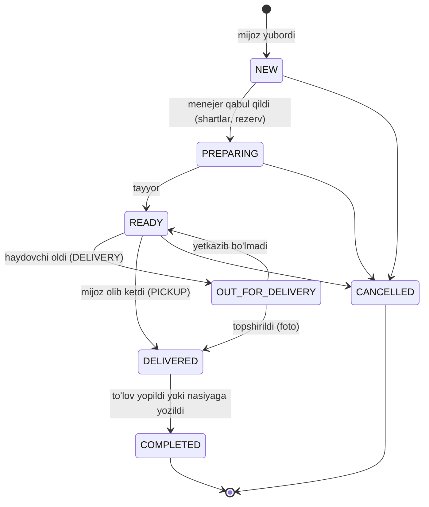
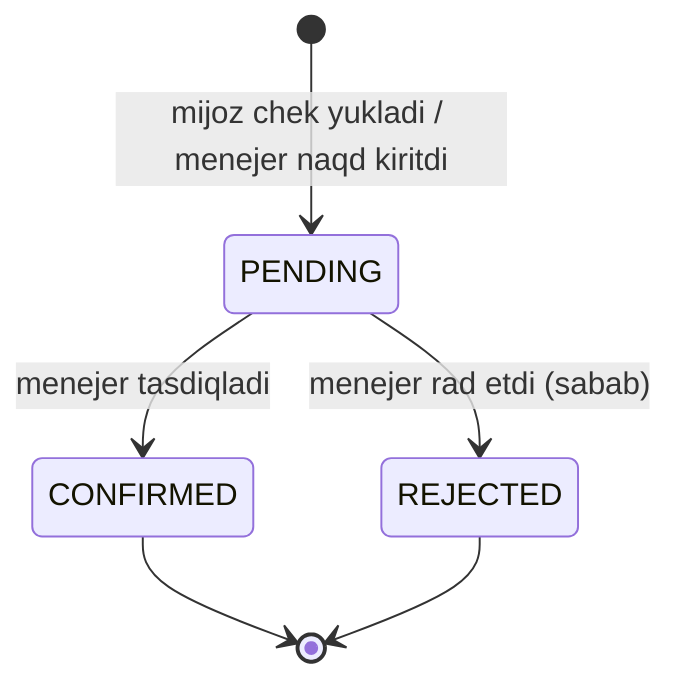

# 02. Buyurtma state machine

## Diagramma

Takliflar (`QUOTED`) va alohida "kelishildi" (`CONFIRMED`) bosqichi yo'q (migratsiya `0002_drop_quotes`):
menejer buyurtmani bir qadamda qabul qiladi. Oldindan to'lovda shartlar avval saqlanadi (`PUT /admin/orders/{id}/terms`),
buyurtma avans tushguncha `NEW`da kutadi.

**Promptdan farq:** `READY_FOR_PICKUP` alohida status qilinmadi. `READY` + `delivery_type = PICKUP` UI'da "Olib ketishga tayyor" deb ko'rsatiladi. Statuslar soni kamroq, mantiq bir xil.

## O'tishlar jadvali

| # | Dan → Ga | Kim qila oladi | Shart (guard) | Yon ta'sirlar (bitta tranzaksiyada) |
|---|---|---|---|---|
| 1 | NEW → PREPARING | MANAGER, SUPER_ADMIN | To'lov shartlari (so'rovda yoki oldin saqlangan). Barcha qatorlar uchun qoldiq yetarli (yoki ON_ORDER). `ADVANCE`/`PREPAID` bo'lsa avans to'langan (yoki SUPER_ADMIN izoh bilan chetlab o'tadi). `CREDIT` bo'lsa yangi balans `<= credit_limit` yoki menejer izoh bilan tasdiqlagan | Shartlar va summalar yoziladi, menejer biriktiriladi, rezerv (`RESERVE`), push mijozga ("qabul qilindi") |
| 2 | PREPARING → READY | WAREHOUSE, MANAGER | Raspil kartalari `DONE` | Push mijozga ("tayyor" / "olib ketishga tayyor") |
| 3 | READY → OUT_FOR_DELIVERY | DRIVER, MANAGER | `delivery_type = DELIVERY`, haydovchi biriktirilgan | Qoldiqdan yechiladi (`OUT`, rezerv `RELEASE`), push mijozga |
| 4 | READY → DELIVERED | WAREHOUSE, MANAGER | `delivery_type = PICKUP`, qabul qiluvchi ismi | Qoldiqdan yechiladi, ledger `DEBIT grand_total` |
| 5 | OUT_FOR_DELIVERY → DELIVERED | DRIVER | Foto va qabul qiluvchi ismi | Ledger `DEBIT grand_total`, push |
| 6 | OUT_FOR_DELIVERY → READY | DRIVER, MANAGER | Sabab majburiy | Qoldiq qaytariladi (`IN` + `RESERVE`), menejerga xabar |
| 7 | DELIVERED → COMPLETED | tizim (avtomatik) | `paid_total >= grand_total` YOKI `payment_terms = CREDIT` | — |
| 8 | * → CANCELLED | CUSTOMER: faqat NEW. MANAGER: NEW, PREPARING (raspilsiz). SUPER_ADMIN: READY gacha hammasi | Sabab majburiy | Rezerv `RELEASE`. To'langan bo'lsa: ledger'da mijoz balansiga qaytariladi (haqdor) yoki `REFUND` yoziladi — tanlov menejerda |

## Amalga oshirishdagi aniqliklar

- **Rezerv:** "buyurtma asosida" (ON_ORDER) tovar qoldiq yetmasa band qilinmaydi; jo'natishda qoldiq bo'lmasa 409 `STOCK_NOT_RECEIVED` — avval kirim qilinadi.
- **Qancha band qilingani** alohida saqlanmaydi, `stock_movements` dan hisoblanadi (RESERVE − RELEASE) — bo'shatish doim aniq.
- **Avansni chetlab o'tish** (`overrideAdvance`) — faqat super admin, izoh bilan. **Kredit limitidan oshish** (`overrideCreditLimit`) — menejer, izoh bilan.
- **Olib ketishda** `receiverName` majburiy, tarixga "Qabul qildi: …" bo'lib yoziladi.
- **Nasiyada** topshirilganda `due_date = bugun + payment_term_days`, buyurtma darhol COMPLETED (qarz ledger'da qoladi).
- **Shartlarni oldindan saqlash** (`PUT /admin/orders/{id}/terms`) — faqat `NEW`da; status o'zgarmaydi, versiya oshadi.
  `PREPAID`/`ADVANCE` bo'lsa mijozga "X so'm to'lang" xabari boradi; to'lov `NEW` buyurtmaga shartlar bor bo'lsa qabul qilinadi.
- **Menejer biriktirish** — buyurtmaga birinchi tekkan menejer avtomatik biriktiriladi; qo'lda almashtirish versiyani oshirmaydi.

## Muhim qoidalar

- **Bitta joyda:** barcha o'tishlar `OrderStateMachine.transition(orderId, to, actor, payload)` orqali. To'g'ridan-to'g'ri `UPDATE orders SET status` taqiqlanadi.
- **Optimistic lock:** `orders.version` ustuni. Ikki menejer bir vaqtda bossa, ikkinchisi `409 Conflict` oladi.
- **Rezerv atomik:** `UPDATE product_variants SET reserved_qty = reserved_qty + $q WHERE id = $id AND stock_qty - reserved_qty >= $q` — 0 qator yangilansa, o'tish rad etiladi va qaysi mahsulot yetmagani qaytariladi.
- **Ledger qachon yoziladi:** qarz (DEBIT) tovar topshirilganda paydo bo'ladi. Oldindan to'langan avans darhol `CREDIT` bo'lib tushadi, ya'ni topshirishgacha mijoz "haqdor" bo'lib turadi. Shunda akt-sverka buxgalteriya mantiqiga mos keladi.
- **Har o'tish:** `order_status_history` + `audit_logs` + WebSocket event + push.

## To'lov oqimi (statusdan mustaqil)

Tasdiqlanganda (bitta tranzaksiyada): `orders.paid_total += amount`, ledger `CREDIT`, `customer_profiles.balance_cached` yangilanadi, buyurtma DELIVERED bo'lsa 7-o'tish tekshiriladi.
